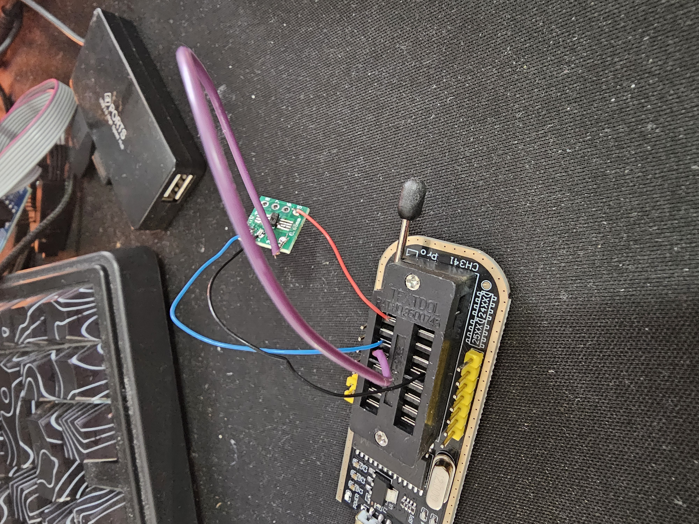
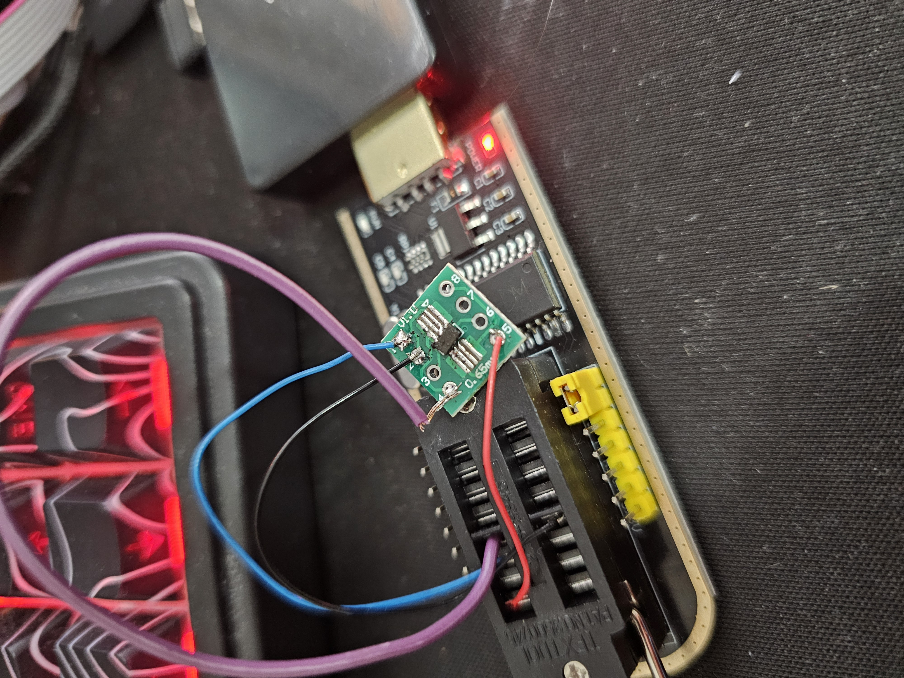
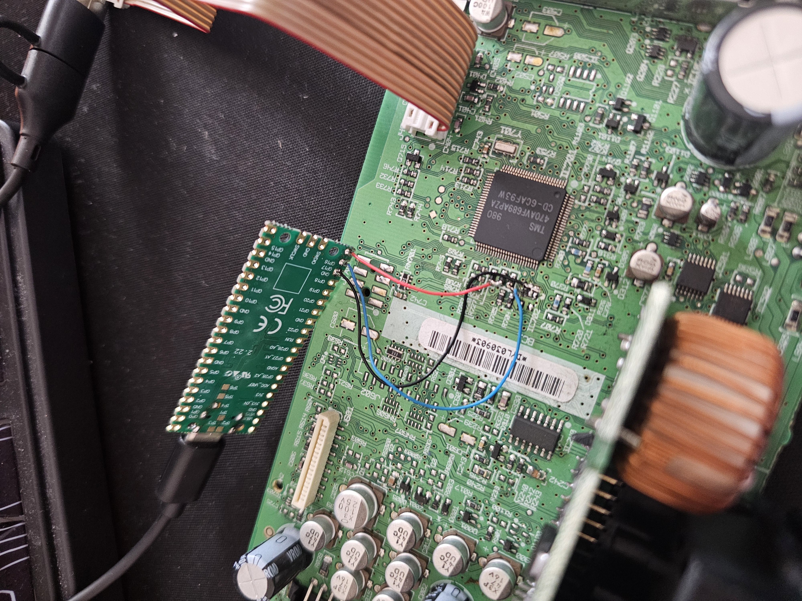
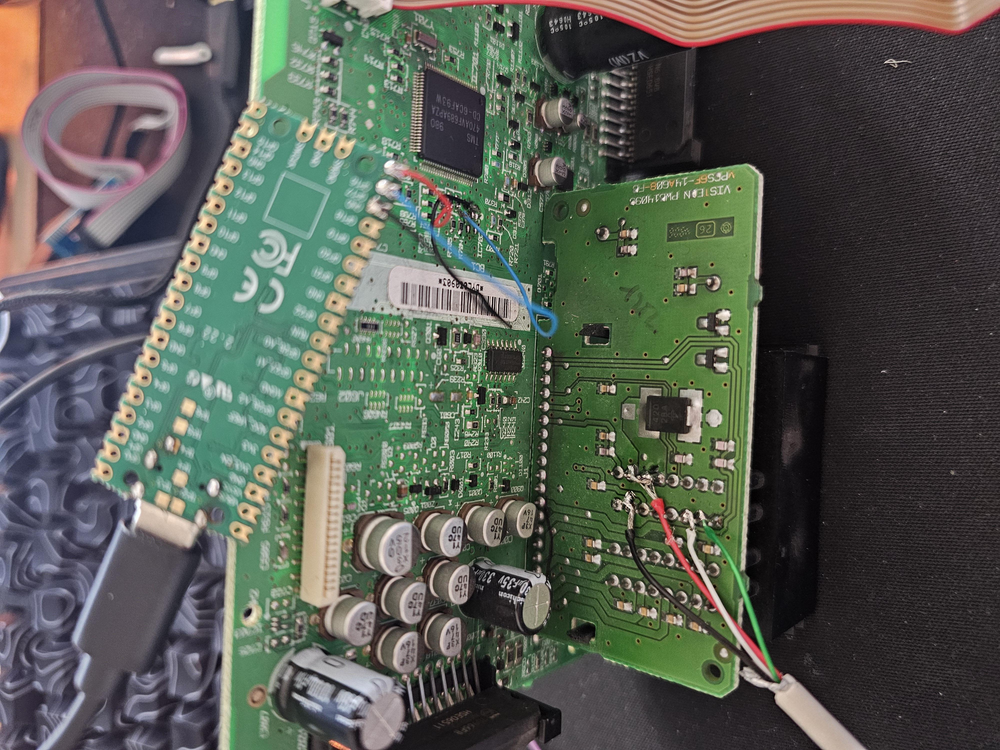
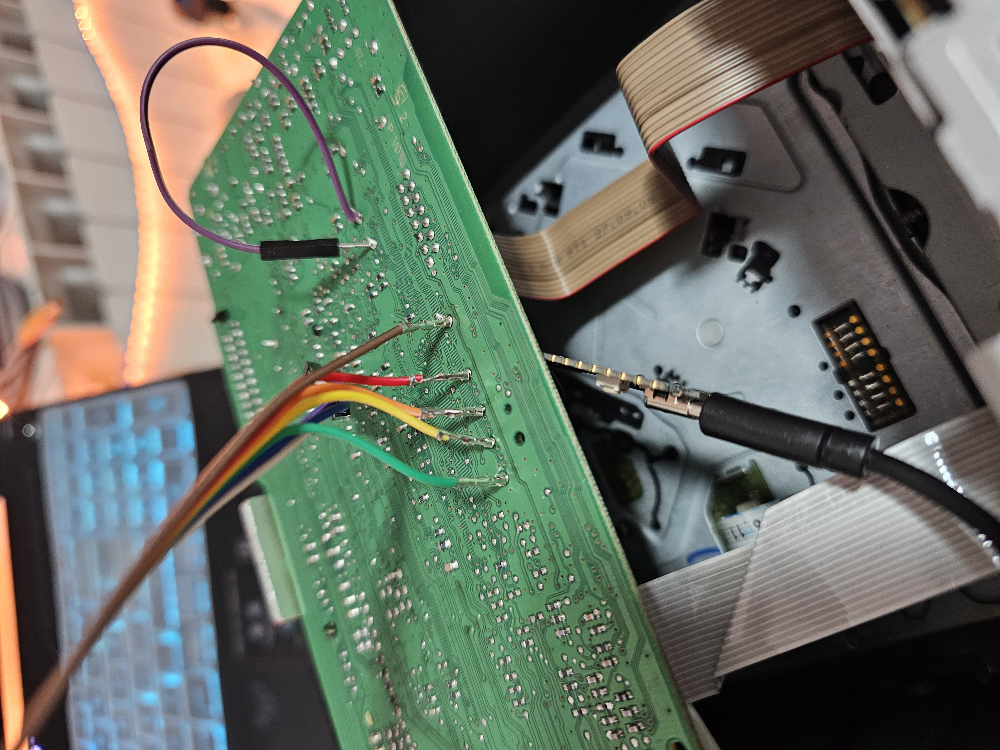
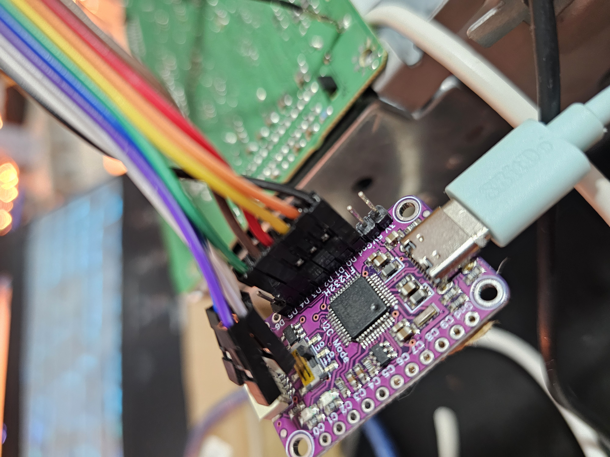
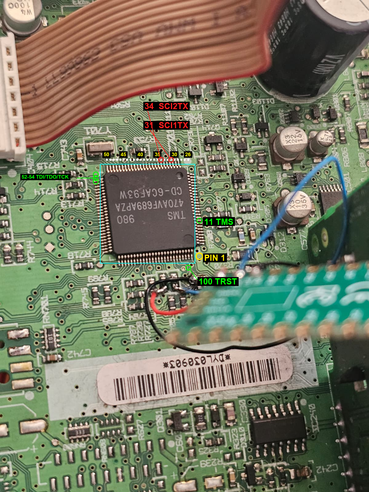
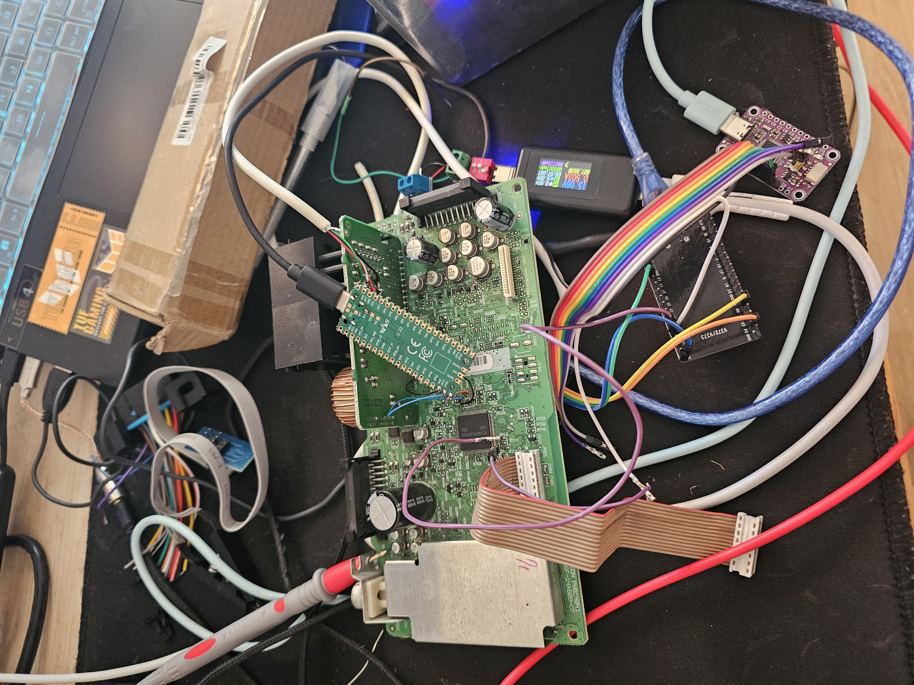

# Ford 6000CD (Visteon, TMS470) unlock - reverse engineering notes

Written as I went, with Claude (Anthropic's AI coding agent) writing the tooling and running
the protocol analysis alongside me, see the README for more on that. Everything here is a
factual record of what was tried, what was found, and what is still unknown, kept so the
work could be picked up again without starting over.

> **Note on this published version:** a few paths mentioned below aren't included in this
> repo as published. See the [README](README.md#references) for sources and credits.

---

## 0. RESUME GUIDE (read this first) - state as of 2026-10-07

Goal: unlock this specific radio so it works in the car. Code 9777 is correct; the radio is in the
permanent LOCKED state (too many wrong attempts). The lock is in TMS470 flash, not the EEPROM (proven).

**What is DONE and working:**
- DIY CAN adapter: ESP32 + SN65HVD230, on **COM10**. Firmware source `esp32/esp32_slcan/`. Self-test passes.
- The radio's CAN is reached and fully driven over UDS. Diagnostic endpoint **request 0x727 / response 0x72F**,
  11-bit, ISO-TP, 125 kbps. Confirmed our unit (serial `FDC2007V020750`).
- **SecurityAccess is CRACKED.** We unlock deterministically: `27 01` -> seed, key = Ford legacy LFSR
  KeyGenMkI(seed, secret), `27 02 key` -> `67 02` granted. Keygen in `security/keygen_ford.py`; the
  specific secret this radio uses is deliberately not published here (see that file's docstring).
- We can reliably enter the bootloader (`10 02` reboots the radio into its **PBL = Primary Boot Loader**,
  id via DID F180 = `06MY XCar PBL v02-02-02`) and hold it, thanks to the firmware keepalive.

**The current WALL (what blocks the actual unlock):**
- The PBL will not read or write application flash directly: `23` ReadMemByAddr not supported, `35`/`34`
  upload/download of flash addresses (0x3FCC, 0x100230, 0x0..0x400000) all return `requestOutOfRange`.
- Ford's model: the PBL only accepts a **Secondary Boot Loader (SBL)** downloaded into RAM; the SBL is what
  actually reads/writes flash. OR the fordradv3 cable uses a custom flash protocol over CAN. Either way the
  flash read/write capability is NOT exposed in the PBL via standard UDS.
- The tool's "Code-Off" (decoded, section 5.3 / 8) needs to READ the current 40 bytes at 0x100230, scramble
  the first 8, fix 2 checksums, and WRITE back. We cannot read flash yet, so we cannot build a safe write.
  A blind write risks a permanent brick (no full firmware image to restore). NO flash write has been done.

**How to resume driving the radio (exact steps):**
1. Hardware: ESP32 on COM10; SN65HVD230 CTX<-GPIO21, CRX<-GPIO22, 3V3, GND; CANH/CANL to radio CAN+/CAN-;
   **common GND radio<->ESP32**; 120 ohm across CANH/CANL (measured 124). Radio powered.
2. `cd "ford radio dump/RE/security"`
3. `python -u unlock_and_read.py COM10` - wakes, enters PBL, unlocks security, tries reads.
   When it prints "waking: firmware bus probe", **power-cycle the radio once (off ~2s, on)** so our traffic
   is on the bus during its boot (that is the only way its CAN wakes). Then it stays awake (keepalive).
4. Reliable building blocks (all in `security/` + `esp32/`): `wake()`+`establish()` (seedkey_brute.py),
   `unlock()` (unlock_and_read.py), `UdsClient` (esp32/isotp_uds.py).

**Firmware state / reflash:** `esp32/esp32_slcan/esp32_slcan.ino`, built binaries in `esp32/build/`.
Commands: `O/L/C/Sn/t/T/r/R/V/N/F/Z/K/Y/G`. `K1` = keepalive (auto frame every 80ms, holds radio awake),
`G` = continuous-TX wake probe, `Y` = loopback self-test. Auto-reset into bootloader does NOT work on this
board; use the **BOOT/EN latch**. Exact reflash:
```
# 1) compile
CLI="C:\Users\<you>\AppData\Local\Programs\Arduino IDE\resources\app\lib\backend\resources\arduino-cli.exe"
& $CLI compile --fqbn esp32:esp32:esp32 --output-dir "...RE\esp32\build" "...RE\esp32\esp32_slcan"
# 2) LATCH: hold BOOT, tap EN(RST), release BOOT. Then:
python -m esptool --port COM10 --before no-reset --after hard-reset --connect-attempts 6 \
    write-flash 0x0 "...RE\esp32\build\esp32_slcan.ino.merged.bin"
```

**PC-side reliability (done, needed because the radio sleeps within ~1s of bus silence):**
- Firmware keepalive `K1` (enabled automatically by `slcan_raw.py` on open).
- `isotp_uds.py` request() matches the service id, handles responsePending (0x78), ignores stale frames.
- `unlock()` retries seed+key (the radio drops the odd request).
- Windows 1 ms timer resolution set in `slcan_raw.py` (`winmm.timeBeginPeriod(1)`).

**Update 2026-10-09 (read this before resuming further):** JTAG, SCI/UART, AND the RoutineControl ID search
were all tried exhaustively and are now CLOSED - see 5.8/5.9. JTAG: TAP answers (IDCODE 0x3100e02f) but the
TMS470's proprietary dual-TAP scan emulation means our FT232H+OpenOCD can never halt the ARM core; this needs
a TI XDS emulator, not a config fix. SCI: found and tapped a genuinely live UART (pin 34/SCI2TX, soldered,
57600 baud) plus two more active serial lines, but all of them are binary inter-module comms (not a text
console) - no debug log exists on this firmware. RoutineControl: the ENTIRE 0x0000-0xFFFF ID space was swept
via startRoutine; exactly three IDs exist (0x0301, 0xFF00, 0xFF01), all flash program/erase/check routines -
**there is no RAM-execution/SBL-launch routine exposed on this PBL, definitively, not just "not found yet."**
What DOES still work and remains useful: `0x34`/`0x36`/`0x37` write arbitrary bytes to ANY address in the
TMS470's 16KB RAM (base `0x00400000`) via the PBL over CAN - fully confirmed, safe, reusable foothold
(`security/ram_probe.py` etc) - it just has no in-PBL trigger to execute what's loaded there.

**Next directions (the ID-guessing route is now exhausted; these are what's left):**
1. Extract the **SBL** and/or the exact flash read/write sequence from fordradv3 (we have `analysis/
   tool_memory.dump`, the disassembly, and the decoded command set). If we get the SBL + how it's invoked,
   we can load it into the confirmed-working RAM channel, then read 0x100230, replicate Code-Off, and
   write safely. This is now the only software path left that could reach flash.
2. Idea from the user: change the TMS470 boot order / boot a custom loader. Needs flash/option-byte write,
   so it depends on (1) first. The Pico (COM16) can emulate the 24C16 live but the lock is not in EEPROM.
3. Fallbacks: the genuine `USB_FT232RL` cable (tool then just works; we already removed the security
   unknown); or a shop; or a donor radio of the same part number.
4. Fault injection (section 5.6.1) - unexplored, no known recipe for this chip, would be open-ended research.

See the memory note `ford-radio-unlock.md` for the short version. Full detail below, including sections
5.8 (JTAG dead end) and 5.9 (RoutineControl mapping) for the latest work.

---

## 1. The radio and the problem

- Car: Ford Galaxy Mk3, ~2012. Radio is older than the car.
- Unit: Ford 6000CD, Visteon, board marked `VISTEON PWB 14041` / `VP656F-14A608-CF`.
- Dump part number (from EEPROM bytes 0x02-0x0F): `6M2T-18C815-AG`.
- Processor: TI `TMS470AVF689APZA` (IC701), read-protected.
- EEPROM: 24C16 in SOT23-5 (IC702), next to the processor.
- Serial (from 1+6 display): `V020750`, dated 11.01.2007, FDC200.
- Security code: **9777** (confirmed with an online serial->code calculator). The code is correct.
- Symptom: display shows `LOCKED`, will not accept any code entry. 1+6 shows the serial. This is the
  permanent lockout state after too many wrong attempts.

## 2. Where the code and lock actually live (confirmed)

- The serial `V020750` is **NOT** present in the 24C16 dump in any encoding (ASCII/BCD/binary). It lives
  in the TMS470.
- The code 9777 is **NOT** stored in the EEPROM in plaintext/BCD/binary either. It is derived/held in the
  TMS470 (the online calculator derives it from the serial).
- The lock/attempt state is **in the TMS470 flash, not the 24C16.** This was proven three ways:
  - Resetting candidate EEPROM bytes (0x172 counter), clearing the `0x20-0x47` log block, and serving a
    completely blank EEPROM all left the radio showing LOCKED.
  - The commercial unlock tool for this exact variant (see section 7) does NOT edit the EEPROM to unlock;
    it reflashes the TMS470 over its CAN bootloader.
- Conclusion: **no 24C16 edit can clear this lock.** The lock is processor-side.

## 3. 24C16 dump structure (ford radio dump.bin, 2048 bytes)

Non-FF regions and their meaning (as far as understood):
- `0x002-0x00F` ASCII part number `6M2T-18C815-AG`
- `0x020-0x047` a 6-byte-record log (timestamp increments by 0x33; a column counts 13,12,12,11,10).
  Read repeatedly by the radio at boot. NOT the lock (clearing it did nothing).
- `0x05A` single byte `0x97` (read twice at boot)
- `0x094-0x0B4` scattered calibration-looking bytes
- `0x14C-0x153` 8 high-entropy bytes `3f 59 e7 58 75 99 6e 7f` (single copy, no mirror). Looked like an
  encrypted token; changing it is not the unlock.
- `0x154-0x170` 29x `0x5F` ('_'), a blank display-text field
- `0x171-0x179` `00 0e 00 00 02 5f aa 5c 15` (0x172 = 0x0e was the counter guess; not the lock)
- `0x1AC` `10 00`
- `0x1B0-0x2D7` FM station presets + names (KISS FM, EUROPA FM, etc.)
- `0x400+`, `0x58C+` DSP/EQ config and a bitmap-like table

Backups: `pico-eeprom-emulator/orig.bin` is the verified good read (md5 `e1e5ac3f1ec8a2d84f7ec17332ec8367`).
`ford radio dump.bin` and `RPI dump.bin` are identical copies.

## 4. The 24C16 was read with a Pico 24C16 emulator (not a programmer)

The original chip was desoldered; its WP leg tore off. Rather than fight a fragile read, we built a
**24C16 emulator on a Raspberry Pi Pico W** and also used it to feed the radio live.

- `pico-eeprom-emulator/emu.py` - MicroPython. A viper bit-FSM on core1 emulates a full 24C16 (8 banks,
  I2C address 0x50-0x57) on **GP16 = SDA, GP17 = SCL**, with per-byte handling. No clock stretching;
  viper is fast enough at <=100 kHz. Serves `eeprom.bin` and logs every read/write.
- `main.py` auto-starts it. `micropython_picow.uf2` is the exact MicroPython build used (1.29.0, Pico W).
- Validated by reading it back byte-perfect with a CH341A in AsProgrammer, then used in the radio: the
  radio booted, read it, and wrote its settings back. This proved read AND write both work in-circuit.

  
  

- Wiring to the radio: Pico GND/SDA/SCL to the IC702 pads (SDA/SCL are the two pads with the 332 = 3.3k
  pull-ups). Pico on its own USB. Chip left out.

  
  

Usage (dev loop, from Windows with `python -m mpremote`):
```
mpremote connect COM16 fs cp eeprom.bin :eeprom.bin
mpremote connect COM16 run radiocap.py      # serves orig + logs all R/W transactions
```
Experiment runner `eeprom-experiments/runexp.py` patches bytes before serving (edit PATCHES).

## 5. CAN findings (radio on the bench)

- The radio's bus is **MS-CAN at 125 kbps** (500k was silent). Needs a 120ohm (we used 123ohm)
  termination across CANH/CANL.
- The radio does not transmit on its own on the bench; it needs bus activity to wake. Sending any frame
  (we used a confirmed-TX to 0x100) woke it and it ACKed, then broadcast its status once:
  - IDs seen: `1E9, 2D5, 2D8, 2D9, 2DA, 2DB, 2DC, 2E3, 4D0`, plus heartbeat on `50C` (0C 01/02/14 00).
  - `2D9`: `01 77 77 31 00 38 28 28` (the 77 77 stood out vs code 9777, probably coincidence).
- We used the project's own J2534 adapter (FT232H on COM7) with its documented serial protocol:
  send CAN `[0xAA][0x01]...`, received CAN arrives as `[0xBB]...`, set baud `[0xAA][0x02][B3..B0][XOR]`,
  confirmed TX `[0xAA][0x09]...` -> `[0xBE][SEQ][STATUS]`. Scripts: `can/cansniff*.py`, `can/prober.py`.

### 5.1 UDS diagnostic access over CAN (confirmed 2026-10-04, ESP32 adapter)

Full UDS (ISO 14229) diagnostics reached on the bench with the ESP32 SLCAN adapter at 125 kbps.

- **Wake:** the radio's CAN is silent until it sees bus activity. Continuously transmitting while the radio
  powers up (`esp32/probe_window.py`, firmware `G` command) makes its controller come alive and ACK every
  frame; it then stays awake and broadcasts (IDs `1E9, 2D5, 2D8-2DC, 2E3, 4D0, 50C`). An ACK alone does not
  identify an endpoint (every node ACKs every valid frame), so a response scan was needed.
- **Diagnostic endpoint: request `0x727`, response `0x72F`** (11-bit, ISO-TP, 0x00 padding). Found by
  `esp32/can_uds_scan.py` (sweeps IDs with `02 10 01`, filters the broadcast IDs). `0x7DF` functional also
  answers on `0x72F`.
- **Sessions (all positive):** `10 01` default -> `50 01`; `10 03` extended -> `50 03`;
  `10 02` programming -> `50 02 00 19 01 F4`.
- **Identity:** `22 F1 8C` -> `FDC2007V020750` (this radio's serial, confirms the endpoint). `22 F1 90`
  (VIN) all `0x5F` (blank, not car-coded). `22 F1 11/95/97` -> NRC 0x31 requestOutOfRange.
- **`10 02` programming session triggers a full radio reboot** (jump to the bootloader). Reversible: with
  no follow-up it times out and boots back to the locked app. This is the APPL->BOOT transition the
  commercial tool uses; the unlock (flash patch) happens from here.
- Scripts (all in `esp32/`): `probe_window.py` (wake/ACK), `can_respond_scan.py` (raw response sweep),
  `can_uds_scan.py` (UDS endpoint finder), `isotp_uds.py` (minimal ISO-TP/UDS client on 0x727/0x72F).

### 5.2 Bootloader SecurityAccess (confirmed 2026-10-04)

- In the EXTENDED session, SecurityAccess (`27`) and ReadMemoryByAddress (`23`) are rejected
  (`7F 27 serviceNotSupportedInSession`, `7F 23 serviceNotSupported`). They live in the bootloader.
- `10 02` -> `50 02` -> **radio reboots into the bootloader**, which answers on the SAME 0x727/0x72F and
  stays awake under our traffic (`enter_prog_seed.py`).
- Bootloader **SecurityAccess level 01 only**: `27 01` -> `67 01 <3-byte seed>`. `27 05`/`27 09` ->
  `7F 27 subFunctionNotSupported`. The **seed is random/rolling** (every request differs), so the
  seed->key algorithm is required; keys cannot be precomputed.
- Blocker: obtain the level-1 seed->key algorithm. Candidates: (a) reverse it from the tool/cable, but
  the tool's decoded command set (0x04/0xFF/0x02/0x03/bulk) has no visible seed/key step, so the cable may
  do the 27 handshake itself (algorithm in cable firmware, which we do not have); (b) a known Ford/Visteon
  6000CD bootloader algorithm from unlock communities; (c) determine whether the flash/unlock operation
  even needs security (probe which services the bootloader allows, carefully, no erase/write yet).
- Not yet done (needs the key, and is the risky part): RequestDownload (`34`) / TransferData (`36`) /
  RoutineControl (`31`) and the actual "Code-Off" flash patch at `0x3FCC` / `0x100230`.

### 5.3 SECURITY CRACKED + programming-service map (2026-10-04)

- **SecurityAccess level 1 secret recovered** (one specific candidate out of jakka351's
  Ford-ECU-Bruteforcer keybag - the exact value is deliberately not published here, see the note in
  `security/unlock_and_read.py`). `seedkey_brute.py` found it with no rate-limiting (the bootloader accepts
  many key attempts). `unlock_and_read.py`/`keygen_ford.py` now unlock deterministically in one shot:
  27 01 -> seed, key = KeyGenMkI(seed, secret), 27 02 key -> **67 02 (granted)**.
- Bootloader service map (with security unlocked): supported = `10, 22(some DIDs), 27, 34 RequestDownload,
  35 RequestUpload, 36 TransferData, 37 TransferExit, 31 RoutineControl, 3E`. NOT supported =
  `23 ReadMemByAddr, 2E WriteDataByID, 3D WriteMemByAddr, 2C, 85`.
- **Flash is read-protected (write-only):** `35` RequestUpload returns `requestOutOfRange` at every tested
  address (0x0..0x400000, incl. 0x3FCC and 0x100230) and every ALFID. So we cannot read flash to get the
  current `0x100230` bytes the Code-Off needs.
- Watched the commercial tool's "Code-Off" function run: it reads 48 bytes at 0x3FCC and 40 bytes at
  0x100230, randomises part of that second block, computes checksums over it, and writes it all back with
  a checksum at 0x10025A. So it isn't applying some fixed unlock patch, it's actually rewriting the lock
  region based on what's already there.
- That's the wall for copying it: we'd need the current 0x100230 content, which we can't read, plus the
  checksum algorithm. The tool's cable almost certainly has its own custom flash channel separate from the
  UDS stack we're stuck with. Writing Code-Off blind, without being able to verify it first, risks bricking
  the radio for good with no way to recover it - held off here pending the owner's call.

### 5.4 Reliability fixes + PBL confirmation + DID map (2026-10-07)

The radio's CAN sleeps within ~1s of bus silence, which made the UDS session flaky (missed seeds, no
responses). Fixed the stack; it is now stable (unlock succeeds first try, scans complete):
- **Firmware keepalive** (`K1`): the ESP32 auto-sends a harmless frame to 0x7FF every 80 ms so the bus never
  goes quiet and the radio stays awake, independent of PC timing. `slcan_raw.py` enables it on open and in
  `wake_firmware`. Firmware also gained `G` (continuous-TX wake probe, used by `probe_window.py`/`wake()`).
- **ISO-TP robustness** (`isotp_uds.py` request()): matches the response service id, treats `7F xx 78`
  (responsePending) as "keep waiting", ignores stale/other-service frames, sends flow control with STmin
  5 ms so the radio does not outrun the 115200 serial on multi-frame responses.
- **`unlock()` retries** seed+key (the radio drops the odd request); 20 tries.
- **Windows timer** pinned to 1 ms (`winmm.timeBeginPeriod(1)` in `slcan_raw.py`); default ~15.6 ms made
  short sleeps/serial timeouts coarse.
- Known limit: the ESP32<->PC link is 115200; fine for request/response, a bottleneck for dense broadcast
  capture. Raise it (firmware `Serial.begin` + Python baud) before a real multi-block flash write.

DIDs readable in the PBL (via `did_scan.py`, `0x22`): only 4, all identification:
- `F180` = `06MY XCar PBL v02-02-02`  (bootSoftwareId -> this is the **Primary Boot Loader**)
- `F18C` = `FDC2007V020750`  (serial), `F191` = `6M2T-14C230-AF`  (hardware part no), `F160` = `02 02 02`.
No flash-mirroring DID. Confirms: flash is not exposed in the PBL; the SBL (or custom flash channel) is
required for any read/write. This is the precise blocker to attack next (section 0, "Next directions").

### 5.5 Two-interface conclusion (2026-10-07)

Observing the commercial tool confirmed the radio has two separate interfaces: the standard UDS stack at
0x727/0x72F (what this project drives directly; its flash read/write is deliberately locked), and the
cable's own custom bootloader channel, a separate, non-UDS protocol that does the actual flash read/write.
That custom channel's CAN framing lives entirely in the cable's own firmware, not in the PC-side tool, so
it isn't something that can be recovered by analysing the tool alone.

Realistic ways out (none pullable from the tool alone):
1. Get the ACM **SBL** from FORScan/IDS (extracted with Ghidra, as the community does) and load it via UDS
   `0x34` to RAM, then read 0x100230 and replicate Code-Off. Proper path, uses the access we already have.
2. Probe the radio's **RoutineControl (0x31)** for a flash-read/write routine (the one supported-but-
   unexplored UDS service). Brick risk (a wrong routine could erase); only with explicit consent + safeguards.
3. The genuine **USB_FT232RL cable**: security is already cracked, so the tool would just work end to end.
   Cheapest guaranteed path to actually using the radio in the car.

### 5.6 JTAG attempt (2026-10-08): TAP reached, but halt blocked by TI emulation + JSM

Tried direct JTAG on the TMS470 (FT232H + OpenOCD) to bypass CAN entirely.
- Processor is **TMS470R1VF689** (= our TMS470AVF689): ARM7TDMI, 384 KB flash (3 banks / 18 sectors), 16 KB
  SRAM, big-endian, 24 MHz. Datasheet SPNS001I saved; 100-pin PZ JTAG pins: TCK=54 TDI=52 TDO=53 TMS=11
  TRST=100 TEST=87 (tie low) TMS2=10 (2nd TAP, int. pull-up) AWD=25 (watchdog).
- Radio has labelled JTAG test points (CarProTool/OBDStar pinout): TMS, TDO, TCK, TDI, TRST, GND (and VTref).
  Wired FT232H AD0=TCK AD1=TDI AD2=TDO AD3=TMS AD4=nTRST, GND common. FT232H needs **WinUSB via Zadig**
  (it keeps the FTDI driver for the J2534 adapter otherwise; revert in Device Manager).

  
  
- **Watchdog:** AWD (pin 25) is an analog watchdog that resets the chip if the firmware stops writing the WD
  key. For debug it must be disabled: **link AWD to GND** (the pros' "Link for AWD"). Done.
- **Result: JTAG TAP is ALIVE.** IDCODE `0x3100e02f` (TI, ARM7TDMI TAP) reads reliably. But OpenOCD **cannot
  halt**: IR-capture validation fails ("bit 84, all 1s"), EmbeddedICE comms ctrl reads `0x00000000`, halt
  times out. Identical on the Espressif OpenOCD and **mainline xpack OpenOCD 0.12** (downloaded to
  `jtag/xpack-openocd-0.12.0-7/`), little- and big-endian, 10-100 kHz, irmask 0xf and 0x0.
- **Root cause (from TI's own OpenOCD-devel thread "Troubles with SA470R1B1"):** the TMS470R1x uses TI's
  proprietary **scan-based emulation** (dual TAP via TMS/TMS2), which OpenOCD's generic arm7tdmi EmbeddedICE
  path does not drive, so halt/debug fails even though the basic TAP answers. AND the device has a **JTAG
  Security Module (JSM)**: flash cannot be read over JTAG until proprietary keys match (TI NDA; the pro tools
  have them). Flash *read* otherwise needs no FMPKEY; *program/erase* needs the 4 protection keys at the end
  of the first 8K sector. VCCP (flash pump) must be present for any flash op.
- JTAG configs: `jtag/idcode.cfg` (IDCODE, works), `jtag/halt2.cfg`/`halt3.cfg` (halt attempts, fail),
  `jtag/bypass_test.cfg`. OpenOCD at `jtag/xpack-openocd-0.12.0-7/bin/openocd.exe`.
- CONCLUSION: like the CAN path, the JTAG path is gated by TI/Ford proprietary pieces (TI scan-based
  emulation + JSM keys). The DIY route reached the TAP but cannot cross the flash-security line without them.
  The commercial tools (CarProTool, OBDStar DC706) and the fordradv3 cable have these; every *other* unknown
  (serial, code 9777, the UDS security secret) we already removed.

### 5.6.1 No pin disables the code security; fault injection is the only real hardware bypass (2026-10-09)

Direct question asked and checked against the datasheet (SPNS001I) terminal-functions table rather than
guessed: is there a pin that bypasses/disables the MSM code security? Answer: **no**.
- The only two "test" pins on the 100-pin PZ package are **TEST (pin 87)**: "Test enable. **Reserved for
  internal use only**", and **FLTP2 (pin 93, "Flash test pad 2")**: "**must not be connected**" for proper
  operation. Both are TI-internal factory pins (used in silicon test/production), not documented, user-
  accessible security bypasses. Grounding/driving them is a dark unknown-state risk, not a lever.
- Code security is enforced purely from the **128-bit password stored in flash** (MSM) compared internally;
  there is no pin-level override, by design.
- One real datasheet fact worth keeping: **VCCP (pin 92)**, the flash charge-pump voltage, is required for
  **program, erase, AND READ** ("The flash external pump voltage (VCCP) is required for all operations").
  Not a bypass, but relevant if a from-scratch flash-read path is ever attempted.
- The only genuine hardware attack class left is **fault injection** (voltage or clock glitching): disturb
  VCC/VCCP/clock at the precise instant the MSM password-compare executes, to force the compare to pass
  open. This is a real, known attack family (e.g. ChipWhisperer-class tooling, ~250-350 EUR, or a DIY
  crowbar/glitcher), but: (a) no public, proven glitch recipe exists specifically for the TMS470 MSM (would
  be open-ended research, not a known procedure), and (b) it was discussed with the user and NOT pursued -
  recorded here as a known-but-unexplored option, not a dead end.

### 5.7 Community-method + leak research (2026-10-08)

Searched for a shared flash dump / a published chip-security key / a no-tool LOCKED removal. Findings:
- **The serial->code algorithm is the thing the community "cracked" years ago, and we already have it**
  (online calculator gives 9777). Nobody brute-forces the chip security; dump-based code reads use the
  commercial tools (which hold the keys) or shared dumps.
- **Community data recipe for this exact model** (forum post, Ford 6000 SINGLE CD GGDS, TMS470AVF689):
  the code/timer reset uses **80 bytes @ TMS470 flash 0x3FB0** (0x3FB0-0x3FFF, contains our 0x3FCC) **+
  64 bytes @ 24C16 EEPROM 0x140** (0x140-0x17F, contains our 0x172 counter + the 0x14C token). We already
  have the EEPROM block; the missing half is the 80-byte TMS read at 0x3FB0.
- **No-tool LOCKED trick (free, untested by us):** multiple posts report that holding preset **button 6**
  for ~10-60 s (some say **1+6** together) on a powered radio makes a LOCKED unit ask for the code again.
  Worth trying before anything invasive: if it prompts, enter 9777.
- **128-bit MSM/JSM password is NOT public** (searched). SEGGER explicitly will not add an unsecure
  mechanism for TMS470 flash keys. So the key cannot be looked up or brute-forced.
- **J-Link finding (SEGGER forum thread 7935):** on the same chip family (IDCODE 0x3100E02F, ARM7TDMI),
  J-Link halted the core and read/wrote **RAM at 0x00400000** (so SRAM base = **0x00400000**), but its
  flash RAMCode verification failed and **SEGGER does not support the TMS470R1VF** (legacy ARM7). Takeaways:
  (1) halting this core via JTAG IS possible with the right tool, so our OpenOCD halt failure is a tooling
  gap, not a permanent ARM-JTAG lockout; (2) a J-Link clone is NOT a clean fix (flash loader chokes).

Sources checked (for a future session to re-visit if needed; most automotive forums 403 without login):
- SEGGER forum thread 7935 "[SOLVED] TMS470 on J-link with J-Flash" -
  forum.segger.com/index.php?thread/7935-SOLVED-TMS470-on-J-link-with-J-Flash/ - the RAM-base-0x00400000 /
  "legacy ARM7 not supported" source. Device there: TMS470R1VF67 (same IDCODE 0x3100E02F family).
- digital-kaos.co.uk "Ford 6000cd TMS470_288 code from dump" (thread 308770, 59+ pages) and "Ford 6000 cd
  counter reset" (thread 668454) - the 80B@0x3FB0 + 64B@EEPROM-0x140 recipe; login-walled (403 to WebFetch).
- mhhauto.com "Ford 6000cd Locked (SOLVED)" and "ford 6000cd tms reset" - button-6-hold / 1+6 reports;
  login-walled (403 to WebFetch), found via search snippets only, not fully read.
- carprotool.com/download/Pinouts/CarProTool%20Programmer/CPT%20TMS470/tms470r1vf689.pdf - the pinout PDF
  the user linked early on; same datasheet content as SPNS001I.
- iobd.io, codecard.eu, obdexpress.co.uk/blog, eobdtool.co.uk/blog - OBDSTAR DC706 / CarProTool product
  pages confirming these tools support this exact radio (TMS470+24C16) via OBD and BOOT modes; no technical
  protocol detail obtained (commercial product pages, not technical writeups).
- elektroda.pl "Radio Ford seria V 6000CD wyświetla LOCKED" (topic 3463307) - Polish-language, found via
  search, not deeply read.

**The one untested DIY path that uses access we already have (and is read-only = safe):**
Now that SRAM base = 0x00400000 is known, try the bootloader-upload route that our earlier tests missed
(we only ever sent 0x34/0x35 to *flash* addresses, which correctly returned requestOutOfRange):
1. After security unlock in the PBL, probe **0x34 RequestDownload to 0x00400000** (RAM) and **0x35
   RequestUpload from 0x00400000** (RAM). If either is accepted, the PBL exposes RAM transfer.
2. If 0x34-to-RAM works: download a tiny **ARM7 big-endian stub** that copies TMS470 flash 0x3FB0 (80 B)
   and 0x100230 (0x28) into a RAM scratch buffer, start it (0x31 RoutineControl or PBL entry), then read
   that buffer back via 0x35/0x36 from RAM. This finally reveals the lock structure, with NO flash write.
3. Flash WRITE stays off the table until we have a full image to restore (one radio, permanent-brick risk).
This is the "run our own code via the bootloader" idea, using the cracked SecurityAccess we already have.

### 5.7.1 RAM-exploit probe results (2026-10-09) - foothold confirmed, execution gated

Ran the probes (scripts in `security/`: `ram_probe.py`, `ram_download_test.py`, `ram_upload_retry.py`,
`routine_enum.py`). Results, all after a clean SecurityAccess unlock:
- **0x34 RequestDownload TO RAM 0x00400000 is ACCEPTED** with **ALFID 0x44** (4-byte addr + 4-byte size);
  response `74 20 04 06` = max transfer block length 0x0406 (1030 bytes). ALFID 0x14 and 0x24 are refused
  (`7F 34 31`). So the PBL wants the 4+4 length format.
- **Full load path works:** 0x34 -> `74 20 04 06`, then 0x36 TransferData (block seq 1, 16 bytes) ->
  `76 01`, then 0x37 TransferExit -> `77 5F 47`. We can place arbitrary bytes in RAM. (The `5F 47` tail on
  the 0x37 reply is unexplained - possibly a checksum/status of the transfer.)
- **0x35 RequestUpload is refused everywhere** (RAM 0x00400000, flash 0x3FB0, flash 0x100230), with EVERY
  ALFID tried (0x14/0x24/0x44): always `7F 35 31` (requestOutOfRange). The read channel is deliberately
  closed in the PBL. So memory cannot be dumped via UDS; exfil must be done by code we execute.
- **RoutineControl 0x31 subfunction 0x03 (requestRoutineResults) is NOT supported** (`7F 31 12`
  subFunctionNotSupported) for a bogus ID and for all 29 candidate IDs probed (0x0000..0xFFFF incl. the Ford
  erase family 0xFFxx). So routine IDs CANNOT be enumerated safely; the only usable subfunction is almost
  certainly 0x01 startRoutine - the one that executes/erases.

CONSEQUENCE / RISK: we have a confirmed RAM-write foothold, but turning it into a flash read requires
(a) an execution trigger and (b) an ARM7-BE stub that drives the radio's CAN to send flash bytes out.
The only execution trigger is `0x31 01 <routineId>` with an UNKNOWN id, and the same service holds flash
ERASE routines. Firing start-routine guesses on the single radio (no restore image) can permanently brick
it. Safe ways forward: get the Ford VBF/flash file (or FORScan/IDS data) for this module, which specifies
the exact SBL, its RAM download address, and the launch routineId - turning the blind guess into a known
sequence; or use the genuine cable (unlock now guaranteed since security is cracked). Blind startRoutine
guessing is held pending explicit, informed consent.

### 5.8 JTAG halt re-confirmed dead, and the SCI/UART observation plan (2026-10-09)

JTAG halt retried with a config built on the known-good idcode.cfg (`jtag/halt5.cfg`). Decisive evidence:
- OpenOCD auto-probe reported the SAME IDCODE 0x3100e02f TWENTY times, and **IR capture returned all 1s**
  (`saw 0x1111...1` not `...3`) while the DR path (IDCODE) reads perfectly. EmbeddedICE comms ctrl = 0,
  halt timed out.
- Interpretation: the data-register path works but the **instruction-register path is dead**. That is the
  fingerprint of TI's dual-TAP scan-based emulation - the ARM debug logic sits behind a second test line
  (TMS2) that must be driven in TI's proprietary scan format. A standard single-TMS adapter (our FT232H)
  cannot reach it. (Reading IDCODE never proves IR works: a TAP serves IDCODE as the reset-default DR with
  no IR shift.) CONCLUSION: halt/observe via JTAG is impossible with this hardware; it needs a TI XDS
  emulator or a from-scratch reimplementation of TI's scan protocol. Not a config fix. JTAG is closed.

SCI/UART observation (user's idea: listen to the CPU's serial output at boot / bootloader entry).
TMS470R1VF689 **100-pin PZ** SCI pins (datasheet SPNS001I, saved at `jtag/tms470r1vf689_datasheet_SPNS001I.pdf`):
- SCI1: **TX = pin 31**, RX = pin 32, CLK = pin 33.   SCI2: **TX = pin 34**, RX = pin 35, CLK = pin 36.
- Other: PORRST = pin 85, RST = pin 86, OSCIN = pin 23. (CAN SCC: CAN1SRX = pin 58.)
- LQFP numbering: pin 1 at the dot, counterclockwise; left 1-25, bottom 26-50, right 51-75, top 76-100,
  so SCI pins 31-36 are grouped on the BOTTOM edge.
Plan: logic analyzer GND to radio GND, one channel on pin 31 and one on pin 34, sample >=4 MS/s, capture a
power-on and a `10 02` bootloader-entry. A UART TX idles high (3.3 V) with bursts of low pulses; narrowest
pulse = 1 bit, baud = 1/width; decode 8N1. If either pin emits, it is a window into the firmware/bootloader
(and possibly the TMS470 SCI serial bootloader, a separate flash interface). Safe/passive to listen.

Confirmed chip + board: marking TMS470AVF689APZA
CD-6CAF93W, lot 980; chip text is upside-down in the photo so PIN 1 = bottom-right corner. Top edge (ribbon-
cable side) = pins 26..50 with pin 26 at the top-right corner counting left: pin 26-29 EBDADDR[18..15],
30 EBDMAREQ[0], **31 SCI1TX, 32 SCI1RX, 33 SCI1CLK, 34 SCI2TX, 35 SCI2RX, 36 SCI2CLK**, 37/38 CAN2S RX/TX.
Verify orientation via the known JTAG pads: TMS=pin11 (right edge), TDI/TDO/TCK=52/53/54 (left edge),
TRST=pin100 (bottom, by pin 1). The expansion-bus pins (26-30) are likely unused; one has a via (user found
a probe point at pin 30), so pins 31/34 likely have reachable vias too.



SCI CAPTURE RESULT (2026-10-09): pin 31 (SCI1TX) measured 0.04 V = inactive. Pin 34 (SCI2TX) measured
3.17-3.19 V fluctuating = a LIVE UART (user confirmed, and it was the board-blank pin, the factory-debug-on-
an-unrouted-pin pattern). User **soldered** a wire to a test point on that line -> stable tap into ESP32
GPIO34. Baud = **57600** (found by sweep/scoring; `esp32/sci_baudfind.py`). Content is a **periodic binary
comms frame**, NOT a text console: repeats ~every 169 bytes, mostly 0x00 fill, fixed body
`40 00 00 FF FF 00 07 Bx 21 86 41 50 4B("APK") 07 08 08 14 82 CF 21 88 00 00 55 00 00 11 00 4E 00 0C 00 08
00 04 03 00 03 00 03 00 81 21 80`, only the Bx byte (B6/B7/B8) increments. No ASCII strings, no boot banner
across a power-cycle. CONCLUSION: this SCI is an inter-module comms/heartbeat link (CD mech / display / amp),
not a debug log; it does not reveal the unlock. The soldered tap + sniffer firmware remain as reusable
tooling. Captures: `/tmp/sci_cap.txt` (38400, flaky), clean 57600 dumps analysed inline.
Two MORE active serial pins were then probed (wired to GPIO34/35, scored with `esp32/sci_baudfind.py` which
now separates @1/@2): both are also BINARY comms (aliased repeated bytes like 22/62/26 at every baud, no
real words at any rate). CONCLUSION (serial avenue exhausted): this radio exposes NO text debug/command
console on any SCI pin - all active serial lines are binary inter-module comms. SCI does not lead to the
unlock. Pivot back to the CAN RAM-exploit (confirmed 0x34-to-RAM foothold; missing piece = launch routineId).

SCI sniffer TOOLING (implemented 2026-10-09): the ESP32 firmware now taps the SCI lines on **input-only**
pins GPIO34 (chip pin 31 SCI1TX -> "@1") and GPIO35 (chip pin 34 SCI2TX -> "@2") - input-only means it
cannot drive the radio, a safe passive tap; GND already shared via CAN. New firmware commands: `B`/`B2`
auto-measure baud (times shortest bit), `U<baud>` start streaming SCI bytes as @1/@2 hex lines, `U0` stop;
runs alongside CAN (UART1/UART2 vs TWAI). PC tool `esp32/sci_monitor.py` (modes: measure / monitor <baud> /
raw). Flash the firmware with the BOOT/EN latch as usual; binary at `esp32/build/esp32_slcan.ino.merged.bin`.

### 5.9 RoutineControl (0x31) mapping - FULL ID SPACE SWEPT, no RAM-execution routine exists (2026-10-09)

Back on the CAN path after SCI was exhausted. Re-verified the session still works end to end (wake, PBL,
unlock) with no regressions from the SCI work. Scripts in `security/`: `routine_probe.py`, `routine_enum2.py`,
`exec_test.py`, `param_probe.py`, `ram_launch_probe.py`, `routine_sweep_full.py` (last one written but not
run - see below).

- **`0x31 02` (stopRoutine) is NOT supported** (`7F 31 12`), so IDs cannot be enumerated via stop/query;
  only `0x31 01` (startRoutine) responds at all, meaning any ID search necessarily invokes routines.
- **`0x31 01` IS supported** and validates the ID before doing anything: bogus IDs return `7F 31 31`
  (requestOutOfRange) cleanly, no side effects.
- Swept IDs 0x0000-0x0400 plus a curated list (Ford erase family 0xFFxx, common SBL-launch candidates).
  Exactly two IDs are recognised:
  - **`0xFF01`**: responds `7F 31 13` (incorrect message length/format) with no params - almost certainly
    the standard `checkProgrammingDependencies` routine (benign, doesn't erase/write).
  - **`0x0301`**: also `7F 31 13` with no params. Parameter-shape testing (`param_probe.py`) showed it wants
    exactly a **4-byte parameter**: passing 4 bytes changes the response to `7F 31 31` (requestOutOfRange on
    the VALUE, not the length), while any other length stays `7F 31 13`. So 0x0301 takes one 4-byte argument
    and is picky about its range.
  - Tried the RAM base `0x00400000` and `0x00000008` as that 4-byte value: both `7F 31 31` (out of range).
  - `ram_launch_probe.py` then loaded a tiny marker stub (`E3 A0 00 A5 E1 2F FF 1E` = `MOV R0,#0xA5; BX LR`)
    at 16 different addresses across the full RAM window (0x00400000-0x00403FF8, confirming **0x34 download
    succeeds at every RAM address tried**, not just the base) and called `0x0301 <that address>` for each.
    **Every single RAM address was rejected** (`7F 31 31`). CONCLUSION: 0x0301's parameter is a **flash**
    address, not a RAM address - 0x0301 is a flash operation (program/erase/verify), NOT the RAM/SBL launch
    routine we're looking for.
- `routine_sweep_full.py` (bare `0x31 01 <id>`, no params) then swept the REST of the ID space: 0x0400-0x1000,
  0x1000-0x1200, 0x2000-0x2100, 0x3000-0x3100, 0x8000-0x8100, 0xD000-0xD100, 0xDE00-0xE300, 0xF000-0xFFFF
  (~9000 IDs, ran clean, no reboots/anomalies). Found exactly **one more recognised ID: `0xFF00`**
  (`7F 31 13`, same "needs parameters" signature as 0x0301 and 0xFF01).

**FULL ID SPACE NOW EXHAUSTED (0x0000-0xFFFF completely swept across both scripts).** Exactly three
RoutineControl IDs exist on this PBL: **0x0301, 0xFF00, 0xFF01**. 0xFF00/0xFF01 adjacent is the conventional
Ford/Visteon-bootloader pairing for **eraseMemory (0xFF00) / checkProgrammingDependencies (0xFF01)**; 0x0301
is confirmed a flash-address-taking op (program/verify, since it rejected every RAM address - see above).
**0xFF00 was deliberately NOT parameter-probed** - it is very likely the erase routine, and guessing
address/length parameters on a probable erase routine is exactly the brick-risk scenario this whole
investigation has been avoiding; the "needs params" signature alone is enough identification, no need to
trigger it to confirm.

**CONCLUSION (definitive, not a stall): there is no RAM-execution/SBL-launch routine exposed via standard
UDS RoutineControl on this PBL.** All three IDs that exist are flash program/erase/check routines, matching
Ford's documented model where the PBL only ever receives flash commands FROM an already-trusted source (the
dealer tool + its SBL) - it has no "run arbitrary code" entry point reachable by ID-guessing, because that
was never the design. This closes the ID-search approach completely, not by getting stuck but by exhausting
the entire 65536-ID space. The RAM-write foothold itself (0x34/0x36/0x37 to any address in the 16KB RAM)
remains fully confirmed, safe, and reusable - what's missing is not a trigger we haven't found yet, but a
trigger that structurally may not exist on this bootloader at all without the real SBL.
### 5.10 ECUReset (0x11) tested as an alternate execution trigger - also closed, with a clean control (2026-10-09)

RoutineControl being exhausted doesn't rule out every mechanism: some bootloaders check RAM for a valid
image on ANY reset, not via a RoutineControl call at all. We had never sent service `0x11` (ECUReset) in
this whole investigation, so it was a genuinely untested, standard, low-risk (ordinary reset, recoverable)
mechanism. Scripts: `security/ecureset_exec_test.py` (first pass, CAN-recovery-only, inconclusive - see
below), `security/ecureset_sci_test.py` (tried cross-checking via the SCI tap, but the tap had no baseline
signal that run so it was inconclusive too), `security/ecureset_pico_test.py` (the one that worked).

- **`0x11 01` (hardReset) IS supported**: positive response `51 01`, and it performs a real reset (confirmed
  - the very first query call reset the radio on the spot).
- First attempt loaded a marker stub and fired `0x11 01`, then checked whether CAN came back on its own.
  It did, within the wake-probe window. But this is **ambiguous by itself**: the chip's AWD hardware
  watchdog could catch a genuinely hung stub and reboot into flash within that same ~10s window, looking
  identical to "never diverted" from the CAN side alone.
- Tried cross-checking with the soldered SCI tap (watching for the "APK" comms heartbeat to go silent) but
  the tap showed **zero baseline activity** that run (physically disconnected/shifted) - inconclusive, not
  a negative result, honestly reported as such rather than claimed as evidence.
- **Resolved with a better independent channel: the Raspberry Pi Pico 24C16 emulator's live read-counter**
  (`pico-eeprom-emulator/emu.py`, already running, `stats()`/`getlog()` API, driven gently via
  `picorepl.py`'s plain-serial method so the running emulator and its log are never disturbed by mpremote's
  reset-on-connect). Normal firmware does a burst of EEPROM reads at boot; our infinite-loop stub
  (`B .` / `EA FF FF FE`, ARM branch-to-self) never touches I2C at all - so EEPROM read-burst timing after
  the reset is a clean, independent signal for "did flash boot normally."
- **Control run (no stub loaded, just `0x11 01`):** EEPROM reads jumped **+1519** in a single burst,
  landing at **t+1.27s** after the reset, then flat for the remaining 20s watched. This is the normal-boot
  signature.
- **Real run (infinite-loop stub loaded at RAM 0x00400000, then `0x11 01`):** EEPROM reads jumped **+1519**,
  landing at **t+1.26s** - matching the control to within measurement noise (~10ms), same burst size exactly.
- **CONCLUSION: ECUReset does NOT divert execution to RAM.** The chip boots flash identically regardless of
  what's loaded at the RAM base. This is a clean, control-verified negative result, not a guess.

**REMAINING PATHS (two real mechanisms now closed with solid evidence; these are what's left):**
1. Obtain the actual Ford SBL/VBF for this module (FORScan/IDS data, or extracted via Ghidra from a source
   that has it) and load IT into the confirmed-working RAM channel - the SBL, once running, would itself
   expose the real flash read/write/erase routines Ford intended. This is now the only software path that
   could plausibly still reach flash.
2. The genuine USB_FT232RL cable (cheapest, since SecurityAccess is already cracked, it should work end to
   end) - the pragmatic route to a working radio regardless of further RE.
3. A commercial tool/shop with the proprietary keys.
4. Fault injection (section 5.6.1) - unexplored, no known recipe for this chip, open-ended research.

### 5.11 PROJECT CLOSED 2026-10-09 - final lead found, user decided not to pursue further

One more genuine lead surfaced via targeted web research (Chinese/Russian-language searches, since Western
forums are mostly login-walled): a Russian forum thread (auto-bk.ru, "Ford 6000 CD j-link нет подключения")
describes a user (Alex Vlasov) getting **SEGGER J-Link + J-Flash 7.54** working against the exact chip
(TMS470AVF689) in a near-identical radio (part no. 6С1Т-18С815-AG vs our 6M2T-18C815-AG) - past connection
and into an **actual successful flash readback** - by adjusting a J-Flash project setting called **"Activate
mapping"**. No exact values given (thin report, not a reproducible recipe). This is a materially different
class of result than anything else found: it implies SEGGER's commercial J-Flash has correct handling for
TI's proprietary dual-TAP scan emulation where our OpenOCD setup fails at the raw protocol level (IR-capture
itself never completes - see 5.8). Consistent with the earlier SEGGER forum finding (section 5.7) that J-Link
could at least halt/R-W RAM on a sibling chip even where its flash loader failed.
- Same thread repeated a claim that reading the 24C16 EEPROM directly cleared the LOCKED prompt without the
  code. Treated with real skepticism and NOT pursued further: our own unit was already tested with a fully
  BLANK EEPROM (a strictly stronger test than any selective edit) and stayed LOCKED (section 2) - this claim
  likely does not apply to our exact revision, or is forum folklore.
- **Confirmed FT232H cannot substitute for genuine J-Link hardware here**: SEGGER's J-Link software (J-Flash,
  J-Link Commander, etc.) only drives genuine SEGGER probes (or a short list of SEGGER-licensed OEM debug
  chips on specific dev boards); it has no generic-FTDI/bit-bang mode. The FT232H is electrically equivalent
  (same TCK/TMS/TDI/TDO capability) but the gate is software licensing, not hardware capability. The only
  "stay free" alternative would be reverse-engineering TI's undocumented dual-TAP protocol from scratch and
  writing custom bit-bang code (e.g. via `pyftdi`) or patching OpenOCD - open-ended research with no known
  recipe, not attempted.
- Genuine SEGGER J-Link EDU Mini costs ~$18 (non-commercial/hobby licensed, fits this use) - the cheapest
  remaining lead of the entire investigation. **User declined to spend further money or time**: "i wont
  fucking buy a cable for a 15 euro radio" (re: the genuine fordradv3 cable) and finally "i wont spend money
  anymore, i can buy android head units for 30 40 euro" - a more practical outcome (CarPlay/Android Auto
  included) than continuing to chase a 2007 OEM radio's flash security.

**PROJECT STATUS: CLOSED by user decision, not by exhausting every possible avenue.** The J-Link/"Activate
mapping" lead and the from-scratch dual-TAP reverse-engineering option remain open/untried if ever revisited.
Everything else (RoutineControl, ECUReset, JTAG via OpenOCD, SCI, EEPROM) was tested to an actual, evidenced
conclusion, not abandoned early. See the memory note `ford-radio-unlock.md` top for the closure note - a
future session should NOT resume hands-on work on this radio without the user asking again.

## 6. The unlock tool: fordradv3 ("VISTEON CAR RADIO TOOL")

A commercial Ford/Visteon radio-code tool. It has a "Ford Visteon 6000CD Tool" mode with Read/Write EEPROM,
Code Read, Code Change, and Code Off functions. Observing it running confirmed the two-interface picture in
5.5 above: its cable talks a separate, non-UDS protocol to the TMS470's bootloader (distinct from the
standard UDS stack this project drives directly), and that it uses a specific FTDI-based cable the tool
checks for by description string. That cable-side protocol is the cable's own secret, implemented in its
own firmware, and isn't something recoverable from the PC-side tool alone - see 5.5's "realistic ways out"
for what was concluded from this.

## 7. The wall (honest)

- Full software emulation cannot complete: the tool needs genuine bootloader ID / application identity /
  flash contents from the real radio to compute and apply the patch.
- Bridging the tool to the real radio needs the cable's **CAN-side protocol** (bootloader CAN IDs, bit
  rate, ISO-TP framing). That logic is in the cable's own MCU firmware, NOT in the PC tool, so it cannot be
  recovered from fordradv3.exe or from the radio alone.
- We fully cracked the PC/USB side. The missing piece is physical: the cable, or its CAN firmware.

## 8. Next steps / open experiments (for tomorrow with ESP32 + SN65HVD230)

Idea: test whether the cable is a transparent USB<->CAN(ISO-TP) bridge. If it is, the boot-framework frames
are the bootloader messages and we already know the command protocol (0x04 get-state, 0xFF switch, etc.),
so we can drive the TMS470 bootloader directly over CAN with the ESP32 + SN65HVD230 (or the J2534 adapter).

Safe, read-only probe plan (power-cycle restores the radio as long as NO flash write happens):
1. On the real radio's MS-CAN at 125 kbps, try to find the bootloader request/response CAN IDs.
2. Send the equivalent of GET_DEVICE_STATE; if the radio answers "APPL", the mapping is right.
3. Send DEVICE_STATE_SWITCH; confirm it reports "BOOT" (reversible by power cycle).
4. Read bootloader ID/version. Only then consider the (risky) erase/write.

If that mapping can be found, the clean architecture is a bridge:
`fordradv3 -> Frida virtual FTDI -> Python bridge -> ESP32/J2534 -> CAN -> radio bootloader`,
feeding the tool real responses so it computes and applies the real Code-Off patch.

Unknowns to solve: bootloader CAN IDs, whether bytes 1.. of the frame map 1:1 to the CAN/KWP payload (minus
the USB checksum), ISO-TP parameters, and the CAN_CONFIG bit rate the tool expects.

Alternative if the CAN bridge proves impossible: borrow the genuine `USB_FT232RL` cable, then the tool just
works as designed (we removed every other unknown). Zero-risk fallback: a donor radio of the same part
number, use its own code.

### 8.1 ESP32 CAN adapter (built and verified 2026-10-04)

The ESP32 + SN65HVD230 adapter is flashed and tested on the serial side. It runs a custom SLCAN (Lawicel)
firmware so the PC can drive it with python-can's `slcan` backend plus `can-isotp`/`udsoncan` for UDS.

- Board: ESP32-D0WD-V3 (rev 3.1), on **COM10** (Silicon Labs CP2102, VID:PID 10C4:EA60), MAC 78:42:1C:67:DE:F0.
- Firmware source: `esp32/esp32_slcan/esp32_slcan.ino` (compiled with the arduino-cli bundled in Arduino IDE
  2.x: `...\Arduino IDE\resources\app\lib\backend\resources\arduino-cli.exe`, core `esp32:esp32` 3.3.8).
- Uses the ESP-IDF TWAI driver (`driver/twai.h`). SLCAN @ 115200 8N1. Default bitrate S4 = 125k (MS-CAN).
- **Wiring (ESP32 -> SN65HVD230 / VP230 blue module):**
  `GPIO21` = TWAI TX -> module `CTX`/`D`; `GPIO22` = TWAI RX -> module `CRX`/`R`; `3V3`->`3V3` (it is a 3.3V
  part, not 5V); `GND`->`GND`; `CANH`/`CANL` -> radio MS-CAN; a 120 ohm termination across CANH/CANL if the
  bench harness has none.
- **Flashing gotcha:** this board's auto-program circuit does NOT pull GPIO0 low on its own. esptool alone
  gives `Wrong boot mode (0x13)`. Fix: **hold BOOT as soon as `Connecting....` appears and keep holding
  until `Writing at 0x...`**, then release. `flash_slcan.py` prints this reminder and does the flash.
- SLCAN commands implemented: `O`/`L` open normal/listen-only, `C` close, `Sn` bitrate, `t`/`T`/`r`/`R`
  transmit, `V`/`N`/`F` version/serial/status, `Z0`/`Z1` timestamp. Listen-only (`L`) keeps the adapter
  electrically passive for safe first-contact sniffing.

Tomorrow's safe, read-only procedure (power-cycle restores the radio as long as NO flash write happens):
1. `python can_bitrate.py COM10` - confirm the bus rate passively (expect 125k).
2. `python can_sniff.py COM10 125000 20` at power-up - capture the IDs the radio emits.
3. `python uds_probe.py COM10 125000` - find which request ID gets a reply, and from which response ID
   (this transmits; the adapter must be wired to the radio and the radio powered).
4. Once the diagnostic pair is known, step up to GET_DEVICE_STATE over ISO-TP (expect "APPL"), then
   DEVICE_STATE_SWITCH (expect "BOOT", reversible by power cycle). Read ID/version only; defer any write.

## 9. File manifest (this RE folder) - updated 2026-10-09

- `pico-eeprom-emulator/` emu.py, main.py, radiocap.py, montest.py, orig.bin, micropython UF2. The Pico W
  24C16 emulator (GP16=SDA, GP17=SCL), COM16. Currently still wired live to the radio's EEPROM pads (IC702).
- `tool-reverse-engineering/` Frida scripts and analysis:
  - `frida_run.py` spawns fordradv3 under a JS hook: `python frida_run.py <script.js>`.
  - `crack.js` the current emulator (device spoof + sum checksum + APPL/BOOT state machine + command log +
    status capture). **This is the main script to keep iterating.**
  - `virt_ftdi.js`, `deob.js`, `frida_hook.js` earlier stages (echo emulator, memory-watch, hook probing).
  - `dump2.py` dumps the live process memory to `analysis/tool_memory.dump` and strings to
    `analysis/tool_strings.txt` (fix was `ptr.readByteArray`, not `Memory.readByteArray`, in Frida 17).
  - `crc_scan.py`/`crc_layout.py` CRC table search / layout solve.
  - `find_crc*.py`, `find_crcerr.py`, `disasm*.py`, `readstr.py` locating and disassembling the checksum
    and state-parse code.
- `can/` cansniff*.py, prober.py, udsscan.py (J2534-adapter CAN tooling, superseded by the ESP32 adapter).
- `esp32/` ESP32 SLCAN CAN adapter (built + verified 2026-10-04) on **COM10**:
  - `esp32_slcan/esp32_slcan.ino` firmware source (CAN SLCAN + SCI sniffer, see below); `build/` compiled
    binaries (`esp32_slcan.ino.merged.bin` is the full flashable image, `.bin`/`.bootloader.bin`/
    `.partitions.bin` are the parts).
  - `flash_slcan.py` compile(optional)+flash with the BOOT-hold reminder; `find_esp32.py` port auto-detect.
  - `slcan_raw.py` raw SLCAN client: listen-only + normal, firmware wake (`wake_firmware`), keepalive on
    open, 1ms Windows timer. Core transport for everything below.
  - `isotp_uds.py` minimal ISO-TP/UDS client (`UdsClient`) talking only to 0x727/0x72F: single+multi-frame,
    service matching, responsePending, flow control. The read-only probe `main()` reads sessions/DIDs.
  - `probe_window.py` firmware `G` wake probe + live ACK (used to wake the radio with a power-cycle).
  - `ack_probe.py` is a live-node-by-ACK bitrate check. `can_bitrate.py`/`can_sniff.py` passive (listen-only).
  - `can_respond_scan.py` raw response sweep; `can_uds_scan.py` found the 0x727/0x72F UDS endpoint.
  - `uds_probe.py` early python-can ISO-TP probe; `uds_explore.py` broader service/DID exploration;
    `slcan_test.py`/`pycan_test.py` serial smoke tests; `enter_prog_seed.py` early programming-session probe;
    `bus_capture.py` captures all CAN frames while FORScan drives the radio (normal mode + keepalive).
  - `sci_monitor.py` **(2026-10-09)** PC tool for the SCI/UART sniffer: modes `measure [1|2]` (auto-baud by
    timing the shortest pulse), `monitor <baud>` (live decode to ASCII), `raw` (dump everything).
  - `sci_baudfind.py` **(2026-10-09)** sweeps ~9 common bauds, scores each by printable-% and letter-runs,
    reports per-pin (@1/@2) results side by side - the tool that found 57600 baud on the soldered tap.
  - `sniff_20261004_112915.log` an early capture log.
  - Firmware commands (current, after 2026-10-09 SCI additions): `O`/`L` open normal/listen-only, `C` close,
    `Sn` bitrate, `t`/`T`/`r`/`R` transmit, `V`/`N`/`F` version/serial/status, `Z0`/`Z1` timestamp,
    `K0`/`K1` keepalive toggle, `Y` loopback self-test, `G` continuous-TX wake probe, **`B`/`B2` auto-measure
    SCI1/SCI2 baud, `U<baud>` start SCI sniff streaming (`U0` stop)**. SCI sniffer taps **input-only**
    GPIO34 (chip pin 31 SCI1TX -> "@1") and GPIO35 (chip pin 34 SCI2TX -> "@2") on hardware UART1/UART2,
    independent of the TWAI (CAN) peripheral - both run simultaneously.
- `security/` the SecurityAccess crack + bootloader/RAM-exploit probing (NEWEST, start here to resume):
  - `keygen_ford.py` Ford legacy LFSR seed->key (KeyGenMkI, cross-checked) + the 355-secret keybag loader.
  - `bruteforcer_security.cs` jakka351 source we pulled the algorithm + keybag from.
  - `seedkey_brute.py` tried the keybag vs the radio and FOUND the secret; has `wake()`/`establish()`.
  - `unlock_and_read.py` unlock with the known secret (`unlock()`, retries up to 20x), then read-only
    flash/DID probes (`upload_read()` = 0x35/0x36 helper, reused by every script below).
  - `flash_probe.py` service map + upload format matrix; `flash_read_scan.py` readable-range scan (none
    readable). `did_scan.py` DID scan in the PBL (found F160/F180/F18C/F191).
  - **RAM-exploit chain (2026-10-08/09, chronological):**
    - `ram_probe.py` first test of 0x35-from-RAM and 0x34-to-RAM at 0x00400000 (download ACCEPTED).
    - `ram_download_test.py` confirms the FULL load path (0x34+0x36+0x37) actually writes RAM successfully.
    - `ram_upload_retry.py` retried 0x35 upload with the ALFID that worked for download (0x44) - still
      refused everywhere; confirms the read channel is closed regardless of ALFID.
    - `routine_enum.py` / `routine_enum2.py` tried to enumerate RoutineControl IDs safely via subfunction
      0x03 (requestRoutineResults) and 0x02 (stopRoutine) respectively - **both subfunctions unsupported**
      (`7F 31 12`), so safe enumeration is impossible; only 0x01 (startRoutine) responds.
    - `routine_probe.py` confirmed 0x01 IS supported and validates IDs (bogus -> `7F 31 31`, no side effect).
    - `exec_test.py` loads the marker stub (`E3 A0 00 A5 E1 2F FF 1E` = `MOV R0,#0xA5; BX LR`) at RAM
      0x00400000 and sweeps ~1034 startRoutine IDs - found exactly **0x0301** and **0xFF01** recognised.
    - `param_probe.py` found 0x0301's parameter shape: exactly 4 bytes (other lengths -> `7F 31 13`).
    - `ram_launch_probe.py` called 0x0301 with the stub loaded at 16 different RAM addresses across the
      full 16KB window - **every RAM address rejected** (`7F 31 31`), proving 0x0301 takes a FLASH address,
      not a RAM address, i.e. 0x0301 is a flash op, not the RAM/SBL-launch routine.
    - `routine_sweep_full.py` written to sweep the rest of the ID space (0x0400-0xFFFF) with bare startRoutine
      calls (no params, safe) looking for a second recognised ID - **written but not yet run**.
- `eeprom-experiments/` runexp.py, exp1_counter0.bin (the counter-zero experiment, byte 0x172 0x0E->0x00;
  proved the lock is NOT in the EEPROM).
- `captures/` key run logs (radio EEPROM access, tool command capture, checksum discovery, disasm, CAN).
- `analysis/` tool_strings.txt, tool_memory.dump (65 MB live memory image of the decrypted tool).
- `jtag/` **(new folder, 2026-10-08/09)** direct-JTAG attempt on the TMS470, and chip/board reference docs:
  - `idcode.cfg` the WORKING config - raw IDCODE scan only, confirms the TAP (0x3100e02f). Safe/non-destructive.
  - `halt2.cfg`, `halt3.cfg`, `halt4.cfg`, `halt5.cfg`, `halt_read.cfg`, `bypass_test.cfg` - every halt/debug
    attempt tried (different endianness, irmask, dual-TAP declaration, IR-capture bypass). **ALL FAIL**
    identically (IR capture all-1s, EmbeddedICE comms ctrl 0, halt times out) - root-caused to TI's
    proprietary dual-TAP scan-based emulation, which no standard OpenOCD arm7tdmi target can drive.
  - `xpack-openocd-0.12.0-7/` mainline OpenOCD 0.12.0 (downloaded to rule out the Espressif fork as the
    cause - identical failure). `openocd-mainline.zip` the original download.
  - `spnu243_security.pdf` + `spnu243_text.txt` - TI's **TMS470R1x Memory Security Module Reference Guide**
    (the MSM/JSM security spec: Mode 1 128-bit password + PMF unlock flow, Mode 2 64-bit permanent block
    disabling ARM JTAG scan, password stored 8 words from end of first flash sector, "default all-1s
    password = unsecured"). This is the document that explained WHY halt fails on a secured device.
  - `tms470r1vf689_datasheet_SPNS001I.pdf` - full TI datasheet "TMS470R1VF689, TMS470R1VF688 16/32-bit RISC
    Flash Microcontrollers" (70 pages), fetched and saved 2026-10-09. Source of every pin-number fact below.
  - `pin_probe_annotated.png` - the board photo (user's) with the TMS470 package location auto-detected
    (pixel bbox x=325-634, y=533-856) and pin positions computer-drawn on top: red = SCI1TX(31)/SCI2TX(34)
    targets, green = JTAG verify pins (TMS=11, TDI/TDO/TCK=52/53/54, TRST=100), yellow = inferred PIN 1
    (bottom-right corner in the photo's orientation, chip text upside-down). Generated with a small PIL/
    numpy script (package auto-detected via grayscale-band thresholding, not committed as a separate file).

## 10. TMS470AVF689APZA pinout reference (100-pin PZ/LQFP) - consolidated 2026-10-09

Confirmed chip marking on the board (photo): **TMS470AVF689APZA / CD-6CAF93W / 980** (Visteon build code +
lot). Datasheet: `jtag/tms470r1vf689_datasheet_SPNS001I.pdf` (SPNS001I, Feb 2002, rev Aug 2005).

LQFP numbering: pin 1 at the package dot/dimple, counterclockwise. In the reference board photo the chip
text reads upside-down, so **PIN 1 = bottom-right corner** of the chip as photographed (inferred from text
orientation, not a confirmed dimple read - cross-check via the JTAG pins below before trusting blindly).
Edges (as photographed): left=1-25, **top(ribbon-cable side)=26-50**, right=51-75, bottom=76-100.

| Pin | Signal | Notes |
|---|---|---|
| 11 | TMS | right edge; JTAG mode select |
| 10 | TMS2 | 2nd (dual-TAP) test-mode select, internal pull-up; part of TI's proprietary scan emulation |
| 25 | AWD | Analog WatchDog; must be grounded to disable WD resets during JTAG debug ("Link for AWD") |
| 26-29 | EBDADDR[18..15] | expansion-bus address, unused on this board (no via found) |
| 30 | EBDMAREQ[0] | expansion-bus DMA request, unused (user found a probe-point/via here anyway) |
| **31** | **SCI1TX** | measured **0.04 V = inactive**, not used by this firmware |
| 32 | SCI1RX | not probed (chip input; nothing to read without driving it) |
| 33 | SCI1CLK | - |
| **34** | **SCI2TX** | measured **3.17-3.19 V fluctuating = LIVE UART**; blank/unrouted on the PCB |
| 35 | SCI2RX | - |
| 36 | SCI2CLK | - |
| 37/38 | CAN2SRX/STX | second CAN controller, not the one we use |
| 52 | TDI | left edge; JTAG data in |
| 53 | TDO | left edge; JTAG data out |
| 54 | TCK | left edge; JTAG clock |
| 58 | CAN1SRX | the CAN controller we actually talk to (0x727/0x72F) |
| 85 | PORRST | power-on reset input |
| 86 | RST | reset |
| 87 | TEST | "reserved for internal use only" - NOT a user bypass, do not use |
| 92 | VCCP | flash charge-pump voltage; required for program/erase/**read** |
| 93 | FLTP2 | "flash test pad 2"; **must not be connected** |
| 100 | TRST | bottom edge, near pin 1; JTAG reset. Has internal pull-DOWN + board pull-up resistor, so a
  continuity meter will NOT beep to it directly (goes through a resistor) - don't use it for orientation
  checks, use the TDI/TDO/TCK trio or TMS instead. |

Orientation cross-check procedure (multimeter continuity, radio OFF): the TDI/TDO/TCK trio (52/53/54) are
three ADJACENT legs; confirm which edge/corner they fall on and that TMS (11) is on the opposite edge. If
that matches the table above, the rest of the pin map (and the SCI pin identities) follows directly.

SCI measurement method note: a live/enabled UART TX idles at a steady logic-high (here ~3.3 V) and dips
briefly during byte transmission; an inactive/unused pin reads near 0 V or floats. This is how pin 31 vs 34
were told apart before any wiring was done.

## 11. Environment notes

- Pico serial: COM16. J2534 adapter (FT232H): COM7 (also reused for JTAG via Zadig WinUSB - **must be
  reverted to the FTDI driver in Device Manager to use the J2534 adapter again**). ESP32 SLCAN adapter:
  COM10. Tool FTDI target desc: `USB_FT232RL`.
- Tools used: Python 3.11, `mpremote`, `pyserial`, `frida`/`frida-tools` 17.x, `python-can` 4.6.1,
  `can-isotp` 2.0.7, `udsoncan` 1.26.1, arduino-cli 1.4.1 (bundled in Arduino IDE 2.x), esptool 5.4.0,
  OpenOCD (both the Espressif fork and mainline xpack 0.12.0), `pypdf` (for datasheet text/pin extraction).
- Frida 17 API gotchas: `Module.findExportByName` and `Memory.readByteArray` were removed; use
  `module.findExportByName(name)` / `ptr.readByteArray(len)`.
- To run the tool under the current emulator:
  `python frida_run.py crack.js`, then in the tool select "Ford Visteon 6000CD Tool".
- ESP32 reflash always needs the **BOOT/EN latch** (hold BOOT, tap EN/RST, release BOOT, then run esptool
  with `--before no-reset`); auto-reset does not work on this board. The latch "sticks" (holds download
  mode) so the physical latch step and the esptool invocation do not need to be perfectly simultaneous.
- Current physical bench state (as of 2026-10-09 end of session): ESP32 (COM10, CAN to radio + SCI tap on
  GPIO34/GPIO35, one soldered), Raspberry Pi Pico (COM16, I2C EEPROM emulator, wired to IC702 pads),
  and the FT232H (JTAG, WinUSB/Zadig driver) all connected to the radio simultaneously. AWD (pin 25) is
  UNBRIDGED (normal running state; it was only grounded during active JTAG halt attempts).

  
